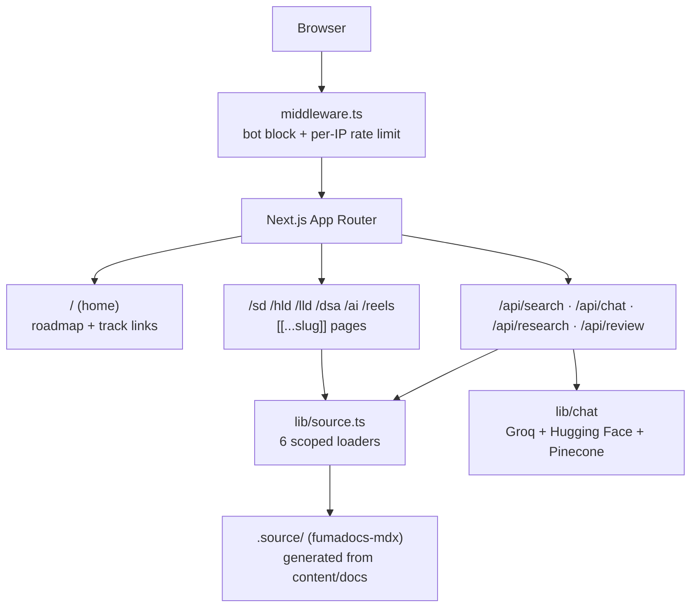
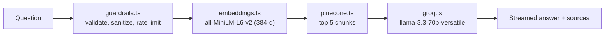

# masstDocs architecture

docs.masst.dev is a free learning site for system design and AI engineering. It is a static-first Next.js 15 app built on Fumadocs, deployed on Vercel. Content is MDX in `content/docs/`. An optional AI chat answers questions using the docs.

## Overview



## Content and routing

All MDX lives in one collection, `content/docs/`. `lib/source.ts` splits it into six scoped loaders. Each one owns a separate folder, so a page belongs to exactly one section, and the folder prefix is stripped from the URL.

| Route | Loader | Folder(s) | Sidebar tab |
|---|---|---|---|
| `/sd` | `source` | everything not listed below: `fundamentals`, `building-blocks`, `architecture`, `communication`, `design-patterns`, `system-components`, `observability`, `security` | System Design |
| `/hld` | `hldSource` | `case-studies/` | HLD Case Studies |
| `/lld` | `lldSource` | `lld/` (foundations, patterns, concurrency, case-studies) | LLD & Patterns |
| `/dsa` | `dsaSource` | `dsa/` (patterns by tier) | DSA Patterns |
| `/ai` | `aiSource` | `ai/` (retrieval, inference, agents, eval, safety, cost, edges) | AI Engineering |
| `/reels` | `reelsSource` | `reels/` (one page per @masstdev reel) | Reel Notes |

Each route has a `layout.tsx` that renders `components/layout/SectionLayout.tsx` (see Look and layout) and a `[[...slug]]/page.tsx` that renders through `components/DocsRenderer.tsx`. Page metadata (canonical URL, Open Graph) comes from `lib/page-metadata.ts`.

Sidebar order and group headings come from each folder's `meta.json`.

**Adding a page:** create the `.mdx` file in the right folder, add it to that folder's `meta.json`, and it appears in the sidebar, search and sitemap automatically.

**Tracks:** sections are grouped into three tracks (Concepts, Designs, Interview) plus Reels in `lib/tracks.ts`. That file drives the top-bar track links and section tabs, the phone tab bar, the `<TrackNav>` bar on each section index, the search filter chips (one per track) and the homepage. URLs do not depend on it.

**Adding a section:** add a folder, a loader in `lib/source.ts` (and exclude the folder from `sdFiles`), a route folder in `app/`, a `layout.tsx` rendering `SectionLayout`, an entry in `SECTIONS` in `lib/tracks.ts`, the loader in `LOADERS` (`lib/roadmap.ts`) and in `app/api/search/route.ts`, and an entry in `app/sitemap.ts`.

## Reel notes

Each @masstdev reel has a page in `content/docs/reels/`. Create one with:

```bash
pnpm new-reel 42 kafka-ordering --title "Why Kafka keeps order" --kind how \
  --hook "Two orders, one partition. Which ships first?" --concept "Partition ordering" \
  --related /sd/building-blocks/message-queues,/sd/building-blocks/pub-sub
```

`scripts/new-reel.mjs` writes the page from `content/TEMPLATE-reel.mdx`, adds it to `reels/meta.json` and adds a row to the reels index table. Reel frontmatter has extra fields defined in `source.config.ts`: `reel` (number), `date`, `instagram` and `related` (course URLs). `app/reels` renders `components/reels/GoDeeper.tsx` under every reel from those fields: the related pages and their track, plus previous and next reels. Clicks are recorded as Vercel Analytics custom events `reel_to_course` and `reel_to_reel`.

## Diagrams

Diagrams are Mermaid code blocks in MDX. Each one is pre-rendered once into a theme-aware SVG file. The page carries only a sized placeholder with a caption; the SVG is fetched from the CDN shortly before it scrolls into view and inlined, so the theme's CSS variables apply. Keeping SVGs out of the HTML keeps pages small (Netflix went from 2.2 MB to 0.4 MB) and cuts ISR reads, and each SVG is cached by the browser across pages.

```mermaid
flowchart LR
    MDX["```mermaid in MDX"] --> PR["scripts/pre-render-mermaid.mjs<br/>Chrome + Nunito, site theme"]
    PR --> SVG["public/mermaid-cache/&lt;hash&gt;.svg<br/>colours = CSS variables"]
    PR --> MAN["manifest.json<br/>natural width, height"]
    MAN --> RM["lib/remark-mermaid-inline.mjs<br/>figure.dg placeholder + caption"]
    RM --> PAGE["Page HTML"]
    SVG -->|"fetched near the viewport<br/>DiagramZoom.tsx"| PAGE
```

- **Theme:** `lib/diagram-theme.mjs` is the single source. Diagrams render with Mermaid's `base` theme using placeholder colours; `lib/diagram-svg.mjs` then turns every colour into `var(--dg-*)` (designed tokens, including the pastel `style` fills used in content) or an automatic light/dark pair scoped to that SVG. Token values are injected in `app/layout.tsx`. Change the look there, then run `pnpm pre-render-mermaid --force`.
- **Font:** rendered with Nunito (`scripts/fonts/`), displayed with the site's Nunito via `--font-nunito`, so labels fit their boxes.
- **Unique ids:** each SVG uses `dg-<hash>`, so styles and arrowheads never leak between diagrams.
- **Sizing** (`.dg` in `app/global.css`): natural size (14px text) when it fits; otherwise shrunk to fit the column and `--dg-max-h`, but never below `--dg-min-scale` (0.62 desktop, 0.55 mobile). Beyond that it scrolls, with a faded edge and a "Scroll" hint. Text never grows past 14px or drops below about 8px.
- **Loading:** the figure links `/mermaid-cache/<hash>.svg?v=<file hash>`; the URL changes whenever the file does, so it is served with a one-year immutable cache header (`next.config.mjs`) and skipped by the middleware. `components/mdx/DiagramZoom.tsx` fetches each one about 1,200px before it is visible. The placeholder has the diagram's exact aspect ratio, so nothing shifts when it arrives.
- **Caption and SEO:** a visible caption (section heading plus diagram type) gives search engines text for every figure. Diagrams with a Cloudinary PNG also get a `<noscript>` image and schema.org `ImageObject` data; the rest get neither, rather than a broken link.
- **Zoom:** click a diagram (or its enlarge button) to open it fitted to the screen; click again for full size. `components/mdx/DiagramZoom.tsx`, mounted once in the root layout, handles this and the scroll hints.
- **Fallback:** a diagram missing from the cache renders in the browser with the same theme and processing (`components/mdx/mermaid.tsx`). Run `pnpm pre-render-mermaid` to cache it.

Commands: `pnpm pre-render-mermaid` renders new or changed diagrams (about 5 seconds for all 905); add `--force` after a theme change and `--prune` to delete unused files. `pnpm dev:watch` re-runs it when content changes. It needs Chrome: `PUPPETEER_EXECUTABLE_PATH`, or `/Applications/Google Chrome.app` on macOS.

`scripts/pre-render-mermaid-seo.mjs` separately makes branded PNGs for Google Images and Cloudinary (needs the Cloudinary variables in `.env`); it only adds PNG fields to the manifest.

## Search

`app/api/search/route.ts` builds one Fumadocs search index over the `sd`, `hld`, `lld`, `dsa` and `ai` loaders. Each result is tagged with its section so the search dialog (`components/search/CustomSearchDialog.tsx`) can filter by section. Reel notes are not indexed yet.

## AI chat (optional)

`components/chat/ChatWidget.tsx` is mounted in `app/layout.tsx` only when `GROQ_API_KEY`, `PINECONE_API_KEY` and `HUGGINGFACE_API_KEY` are all set. Without them the widget is hidden and both APIs return 503.



- `/api/chat`: one retrieval pass, then a streamed answer. 30 requests per minute per IP.
- `/api/research`: `research-agent.ts` splits the question into sub-queries, searches each one and combines the results. 10 requests per minute per IP, 60-second limit.
- `pnpm generate-embeddings` chunks every MDX file and upserts the vectors to Pinecone. Re-run it after significant content changes.
- `pnpm evaluate-rag` scores retrieval quality.
- `/ai-architecture` is a public page that explains this pipeline.

## Practice and AI review

Every HLD and LLD case study ends with a "Try it yourself" box (`components/practice/PracticeBox.tsx`), and a note at the top of the page links to it. The exercises (question, requirements, hints) live in `lib/practice/hld.ts` and `lib/practice/lld.ts`, keyed by page URL; add an entry there when you add a case study.

Readers write an answer, which is saved in their browser. When `GROQ_API_KEY` is set, "Get AI feedback" posts it to `/api/review`. The route grades it against the requirements and the case study's own text (from the page's search data, so Pinecone is not needed) with `llama-3.3-70b-versatile` in JSON mode, and returns a score, what was covered, what was missed and follow-up questions. Limits: 80 to 8,000 characters, 5 reviews per minute per IP, and the chat guardrails' injection check. Without the key, the exercise and hints still show and the feedback button is hidden. Analytics events: `practice_hint`, `practice_submit`.

## Edge, caching and crawlers

- `middleware.ts` runs on every non-static request. It blocks abusive scrapers and requests with no user agent, and rate-limits each IP to 120 requests per minute (in memory, per instance).
- AI search crawlers (GPTBot, ClaudeBot, PerplexityBot, Google-Extended and others) are allowed in both `middleware.ts` and `public/robots.txt`, so AI answers can cite the site.
- `next.config.mjs` sets one-day CDN caching for all section routes and sitemaps, and contains the redirects. `next-pwa` generates the service worker for offline use.
- `app/sitemap.ts` lists every page from all six loaders.

## Look and layout

The site follows the Masst Reels v2 design system (the reels' brand): Nunito everywhere, silver on near-black, rounded corners, and colour only for meaning (`--m-info` selected or moving, `--m-ok` done, `--m-warn` waiting, `--m-fail` broken). Draft screens: claude.ai artifact "Masst Docs redesign".

- **Theme:** `app/theme.css` sets Fumadocs' `--color-fd-*` tokens for light and dark, the `--m-*` tokens, fonts (`--font-nunito`, `--font-jetbrains` from `app/layout.tsx`), radii and the top spotlight. It replaces `fumadocs-ui/css/neutral.css`.
- **Docs layout:** every section uses `components/layout/SectionLayout.tsx` (Fumadocs "notebook" layout): a full-width top bar with the tracks (`TrackLinks`), the current track's sections as tabs under it, and a sidebar whose items (`SidebarItem`) show a check on pages marked done. Phones get `MobileTabBar` (Home + tracks) instead of the top-bar links.
- **Article pages** (`components/DocsRenderer.tsx`): a reading-progress bar, reading time (from the MDX source plus 20 s per diagram), "Mark as done" at the end and in the right rail, "Try it yourself" on case studies with practice, and "Up next".
- **Progress** (`lib/progress.ts`): done pages and the last page read (with the furthest point reached), stored in the browser. Done pages use the roadmap's original key, so the sidebar, roadmap and home page share one list.

## Home page

`app/(home)/page.tsx` (server-rendered): hero with a live SVG diagram (`components/home/HeroDiagram.tsx`, edges drawn to node borders), "Continue where you left off" and "Today's practice" (`HomeCards.tsx`, client), the three tracks with per-section progress, the latest four reels as 9:16 covers, a design of the week (`FeatureDiagram.tsx`) and popular topics. The full roadmap moved to `/roadmap` (`lib/roadmap.ts` builds its tree from all six page trees; `components/ui/SystemDesignRoadmap.tsx` renders it).

## Folder map

```
app/            routes: (home), sd, hld, lld, dsa, ai, reels, api/{search,chat,research,review,pages}
components/     DocsRenderer, chat/, search/, mdx/ (mermaid, TrackNav), home/, reels/, practice/, ui/ (roadmap, Flow, PWA prompt, route progress)
content/        docs/ (all MDX, one folder per section), TEMPLATE-concept.mdx, TEMPLATE-reel.mdx
lib/            source.ts (loaders), tracks.ts, roadmap.ts, practice/, page-metadata.ts, remark-mermaid-inline.mjs, chat/
scripts/        mermaid pre-render (+ SEO/Cloudinary), watcher, embeddings, RAG eval
public/         mermaid-cache/, icons, manifest, robots.txt, sitemaps
```

## Commands

| Command | What it does |
|---|---|
| `pnpm dev:fast` | Dev server, using the committed diagram cache |
| `pnpm dev` | Re-renders new or changed diagrams first (needs Chrome), then starts the dev server |
| `pnpm build` | Re-renders diagrams, then builds for production |
| `pnpm pre-render-mermaid` | Renders new or changed diagrams (`--force` for all, `--prune` to clean up) |
| `pnpm generate-embeddings` | Re-indexes the docs for the chat |
| `pnpm new-reel` | Creates a reel notes page (see Reel notes) |

Deploys happen automatically when `main` is pushed to GitHub (Vercel).
