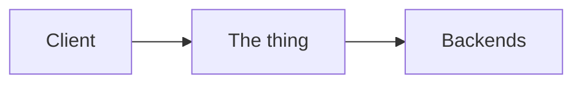

{/* Outline for System Design concept pages (/sd). Same spirit as the AI section:
    a production engineer explaining to a smart reader, with real numbers.
    Aim for 1,500–2,500 words. Keep every heading below, in this order.
    Delete these comments when the page is done.

    Style
    - Short sentences, plain words. Explain a term the first time it appears.
    - Concrete numbers with units (ms, req/s, GB, $). Say "roughly" when it is a rule of thumb.
    - Mermaid for every diagram, labels in double quotes.
    - Name real systems only for claims that are public (papers, engineering blogs, docs).
    - No emoji, no "imagine if...", no filler intros. */}

import { Callout } from 'fumadocs-ui/components/callout';

<Callout type="info" title="TL;DR">
Three or four sentences: what it is, when you need it, the one decision that matters most, and the default choice.
</Callout>

## The problem it solves

A concrete situation where the system breaks without this. Numbers if possible.

## Key idea

The one insight that makes it work, in a paragraph. Bold the core phrase.

## How it works

Walk through the diagram step by step, then go into the mechanics with ### subsections.

## Variants and trade-offs

A table comparing the main options (columns: option, how it works, good for, cost or catch), then a short paragraph on each that needs one.

## Numbers to know

A table of rough figures an engineer should carry in their head: latency added, throughput, limits, default timeouts, cost.

## Common mistakes

### Mistake 1: name it

What people do, why it breaks, what to do instead. Four to six mistakes.

## When not to use it

Cases where this adds cost or complexity without benefit, and what to use instead.

## In the interview

When this comes up, what to say in one or two sentences, and a short capacity example if it fits.

**Follow-up question?**
Answer in two or three sentences. Three to five follow-ups.

## Real systems

Public examples of who uses which variant, with a one-line note each.

## Quick reference

A compact table or list to revise from in two minutes.

## Related

- [Related page](/sd/...): why to read it next
