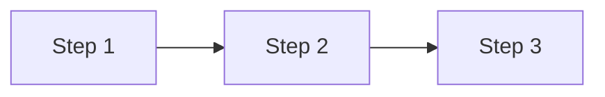

{/* Created by `pnpm new-reel`. Fill in every section, then delete this comment.
    The "Go deeper" card (related pages, track, previous/next reel) is added
    automatically from the frontmatter above: 2–4 course pages, most relevant first. */}

> **Ek line yaad rakho:** {{ONE_LINER}}

{/* Case studies: "## What happened" then "## The interview answer: <concept>".
    How it works: "## The naive design" or a "## The flow" diagram, then the better design. */}

## What happened

## The interview answer: {{CONCEPT}}

## Interview words

| Term | Meaning |
|------|---------|
| Term | One-line meaning |

## Follow-up questions

**First follow-up an interviewer would ask?**
Answer in two or three sentences, naming the concept in **bold**.

**Second follow-up?**
Answer.
