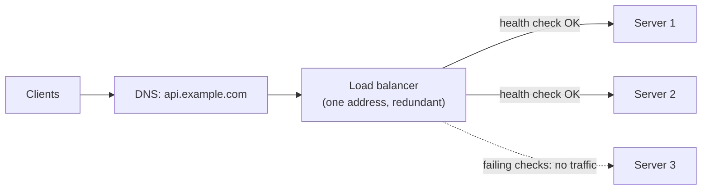
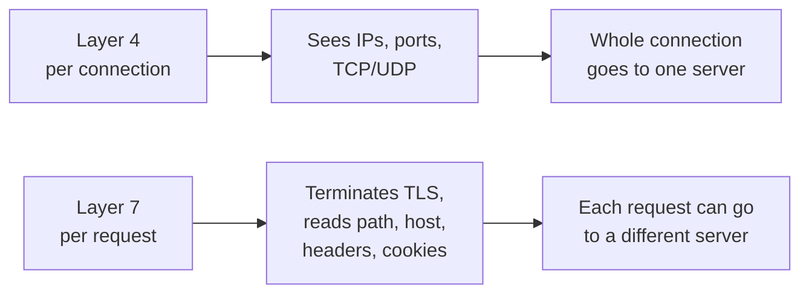

import { Callout } from 'fumadocs-ui/components/callout';

<Callout type="info" title="TL;DR">
A load balancer sits in front of a group of servers and sends each connection or request to one healthy server. **Layer 4** balancers route TCP/UDP connections and add almost no latency; **Layer 7** balancers read HTTP and can route by path, header or cookie. Default to **least outstanding requests** (or round robin for identical, short requests), keep servers **stateless** so you never need sticky sessions, and remember that the balancer itself must be redundant.
</Callout>

## The problem it solves

Your API runs on one server. It handles about 2,000 requests per second before latency climbs. A sale starts and traffic jumps to 15,000 requests per second. You can add servers, but clients only know one address. Something has to accept all the traffic at one address and spread it over many machines.

The second problem is failure. With one server, a crash or a deploy takes the whole product down. With ten servers behind a balancer, one crash costs you 10% of capacity for a few seconds, and users mostly never notice.

So a load balancer gives you two things: **horizontal scaling** (add servers to add capacity) and **availability** (lose a server without losing the service).

## Key idea

**Put one stable address in front of a changing set of servers, and decide per connection or per request which healthy server gets the work.**

Everything else is detail: how much of the traffic the balancer reads before deciding (L4 vs L7), how it chooses (the algorithm), and how it learns which servers are healthy (health checks).

## How it works

1. The client looks up `api.example.com` and gets the balancer's address, not a server's.
2. The client opens a connection to the balancer.
3. The balancer picks a server from the **healthy pool** using its algorithm.
4. It forwards the traffic and relays the response back.
5. In the background it keeps probing every server. A server that fails its checks leaves the pool; when it passes again, it rejoins.

### Layer 4 vs Layer 7

The "layer" is how much of the traffic the balancer reads before deciding.

- **Layer 4 (transport)** looks only at IP addresses and ports. It forwards the bytes of a TCP connection to one server for the life of that connection. It is fast and protocol-agnostic (databases, MQTT, game servers, anything over TCP or UDP), but it cannot route by URL and cannot see individual HTTP requests.
- **Layer 7 (application)** terminates the connection, decrypts TLS, parses HTTP and makes a decision per request. It can send `/api/*` to one pool and `/images/*` to another, add headers, retry a failed request on another server, and apply rate limits. It costs more CPU, mostly for TLS.

A common production shape uses both: an L4 layer that spreads connections across a fleet of L7 proxies, which then route requests to services.

### Choosing a server: the algorithms

| Algorithm | How it picks | Good for | Catch |
|---|---|---|---|
| Round robin | Next server in turn | Identical servers, short similar requests | Ignores how busy each server is |
| Weighted round robin | Round robin, more turns for bigger servers | Mixed instance sizes | Weights are static guesses |
| Least connections | Server with the fewest open connections | Long-lived connections (WebSockets) | Needs connection counts; per-balancer view |
| Least outstanding requests | Fewest in-flight requests (L7) | Requests of very different cost | Only works at L7 |
| Power of two choices | Pick two servers at random, use the less busy one | Large fleets, many balancers | Slightly random by design |
| Hash (IP, header, URL) | Same key always maps to the same server | Cache locality, session affinity | Uneven if keys are skewed; reshuffles on change unless consistent hashing |

**Power of two choices** deserves a note. Asking every server for its load is expensive, and many balancers each picking "the least loaded server" all pile onto the same one. Sampling two at random and taking the better one avoids both problems and gives a far more even spread than pure random. Envoy's least-request balancer uses it by default.

For **hash-based** routing, use [consistent hashing](/sd/building-blocks/consistent-hashing) so that adding or removing a server moves only about 1/N of the keys instead of nearly all of them.

### Health checks

The balancer sends a probe to each server on a schedule, for example `GET /health` every 10 seconds. A server is marked unhealthy after a number of consecutive failures and healthy again after a number of consecutive successes.

- **Shallow checks** confirm the process answers. Cheap, but they pass when the server is up and its database is down.
- **Deep checks** test dependencies too. Accurate, but if the shared database blips, every server fails at once and the balancer has nowhere to send traffic.

The usual answer is a check that covers the server's own critical dependencies without failing the whole fleet together. Some balancers also "fail open": if every server is unhealthy, they send traffic to all of them rather than to none.

Detection time is roughly **interval × unhealthy threshold**. With AWS ALB defaults (30-second interval, 2 failures) that is about a minute; a 5-second interval with 2 failures gets it to about 10 seconds, at the cost of more probe traffic.

### Draining and slow start

When a server is removed for a deploy, cutting its connections mid-request causes errors. **Connection draining** (AWS calls it deregistration delay, default 300 seconds) stops new requests to that server while letting in-flight ones finish.

When a server joins, a cold cache and an unwarmed runtime make it slow. **Slow start** ramps its share of traffic up over a configured window instead of sending it a full share instantly.

### Sessions and state

If a user's session lives in one server's memory, every request from that user must reach that server. **Sticky sessions** do this with a cookie or a hash of the client IP. They work, but they cause uneven load and they lose the session when the server dies.

The better fix is to make servers **stateless**: keep sessions in a shared store such as Redis or in a signed token. Then any server can handle any request, and the balancer is free to spread load evenly.

### Making the balancer itself redundant

A single balancer is a single point of failure. The common patterns:

- **Active-passive pair** sharing a virtual IP. The standby watches a [heartbeat](/sd/building-blocks/heartbeat) and takes over the IP if the active one stops.
- **Active-active fleet** behind DNS with several records, or behind anycast or ECMP routing, so many balancer nodes share the traffic.
- **Managed cloud balancers** (AWS ALB/NLB, Google Cloud Load Balancing), which run as redundant fleets across availability zones for you.

## Variants and trade-offs

| Option | Where it runs | Good for | Catch |
|---|---|---|---|
| DNS load balancing | DNS returns different IPs | Spreading across regions | Clients and resolvers cache answers; slow to react to failure |
| Global (GSLB, anycast) | Edge network routes to the nearest region | Worldwide users, regional failover | More moving parts; needs data replicated across regions |
| L4 balancer | Network layer in front of servers or proxies | Raw TCP/UDP, very high throughput | No HTTP-aware routing |
| L7 balancer or reverse proxy | Terminates HTTP in front of services | Path and host routing, retries, TLS | More CPU and a little more latency |
| Client-side balancing | Inside each client, using a service registry | Service-to-service calls, gRPC | Every client needs the library and the registry |
| Service mesh sidecar | A proxy next to every service | Uniform retries, mTLS and balancing across many services | Operational weight of running the mesh |

In practice these stack. A typical web request goes DNS or anycast to the nearest region, through an L4 layer, to L7 proxies or an [API gateway](/sd/architecture/api-gateway), and from there to services that may balance among themselves through a [service mesh](/sd/architecture/service-mesh).

## Numbers to know

Rough figures for sizing and interviews. Real numbers depend on hardware, request size and TLS settings.

| What | Rough figure |
|---|---|
| Latency added by an L4 balancer | Well under 1 ms |
| Latency added by an L7 proxy in the same region | About 1 ms or less |
| A software L7 proxy (HAProxy, NGINX, Envoy) on a few cores | Tens of thousands to hundreds of thousands of requests per second |
| The usual CPU bottleneck at L7 | New TLS handshakes, not forwarding bytes |
| AWS ALB default health check | Every 30 s, unhealthy after 2 failures, healthy after 5 successes |
| AWS default connection draining | 300 s |
| Keys moved when a server is added (consistent hashing) | About 1/N |

## Common mistakes

### Mistake 1: forgetting that the balancer can fail

Drawing one box labelled "LB" and moving on. Interviewers will ask what happens when it dies. Say how it is made redundant: an active-passive pair, an active-active fleet, or a managed balancer spread across zones.

### Mistake 2: balancing gRPC or HTTP/2 at Layer 4

HTTP/2 sends many requests over one long-lived connection. An L4 balancer places each connection once, so a client with one connection sends all its requests to one server while the rest sit idle. Balance these per request at L7, or use client-side balancing.

### Mistake 3: sticky sessions as the default

Stickiness hides state on the servers, skews load, and loses sessions on every crash and deploy. Move session state to a shared store and turn stickiness off.

### Mistake 4: health checks that test the wrong thing

A check that only returns 200 from the web framework keeps a server in rotation while its database connection pool is exhausted. A check that tests a shared dependency takes every server out at once. Test what this server needs to serve traffic, and know whether your balancer fails open.

### Mistake 5: round robin with very uneven requests

If some requests take 5 ms and others 2 seconds, round robin piles slow work onto unlucky servers. Use least outstanding requests or power of two choices.

### Mistake 6: no draining on deploy

Removing servers without draining turns every deploy into a burst of 502 errors. Enable draining and make the app finish in-flight work on shutdown.

## When not to use it

- **One server is enough and downtime is acceptable**, such as an internal tool. A balancer adds cost and another component to run.
- **Peer-to-peer or client-side discovery already exists.** Inside a service mesh or with gRPC client-side balancing, a central balancer between services can be redundant.
- **Batch or queue-driven work.** Workers pulling from a [message queue](/sd/building-blocks/message-queues) balance themselves: whoever is free takes the next job.

## In the interview

Load balancers come up in almost every high-level design, usually in the first diagram. Say where they sit, which layer, and how they stay available, in one breath:

> "Clients hit a managed L7 load balancer spread across availability zones. It terminates TLS, routes `/api` to the API fleet and checks health every 10 seconds. Servers are stateless, with sessions in Redis, so we use least outstanding requests and no stickiness."

A quick capacity example: peak is 30,000 requests per second, each server handles about 1,500, so you need 20 servers. Add about 30% headroom for a lost zone and deploys, and run 26, spread across three zones.

**What happens when a server dies mid-request?**
The in-flight request fails. An L7 balancer can retry it on another server if the request is safe to repeat (a GET, or a POST with an [idempotency key](/sd/design-patterns/idempotency)). The health check then removes the server within interval × threshold.

**How do you balance WebSocket connections?**
They are long-lived, so place each connection on the server with the fewest open connections and expect imbalance after scale-ups, since existing connections don't move. Reconnect logic with backoff lets you rebalance during deploys.

**L4 or L7 for this design?**
L7 if you need routing by path or host, retries or per-request balancing (HTTP APIs, gRPC). L4 for raw TCP/UDP, extreme throughput, or as the first layer in front of a fleet of L7 proxies.

**How is the load balancer itself not a single point of failure?**
Run several balancer nodes across zones behind DNS or anycast, or an active-passive pair sharing a virtual IP with a heartbeat. Managed cloud balancers do this for you.

**How do you shift traffic across regions?**
With DNS-based or anycast global load balancing in front of the regional balancers. DNS answers are cached, so keep TTLs short (for example 30–60 seconds) if you need fast failover.

## Real systems

- **Google Maglev**: Google's software L4 balancer, described in a 2016 NSDI paper. Routers spread packets across Maglev machines with ECMP, and Maglev uses consistent hashing so connections stay on the same backend.
- **GitHub GLB Director**: an open-source L4 balancer (2018) that uses rendezvous hashing so a connection keeps working while servers are added or removed.
- **Cloudflare**: anycast sends users to the nearest data centre, and Unimog, its L4 balancer, spreads connections across servers inside each one.
- **Envoy**: the L7 proxy behind many service meshes. Its least-request balancer uses power of two choices.
- **AWS**: NLB is the managed L4 option (static IP per zone, keeps the client's IP); ALB is the managed L7 option (path and host routing, gRPC).

## Quick reference

| Question | Answer |
|---|---|
| L4 vs L7 | L4 routes connections by IP and port; L7 routes requests by HTTP content |
| Default algorithm | Least outstanding requests, or round robin for uniform requests |
| Sessions | Make servers stateless; avoid sticky sessions |
| Failure detection time | Interval × unhealthy threshold |
| Deploys | Connection draining on removal, slow start on join |
| Balancer redundancy | Active-passive with a virtual IP, active-active fleet, or managed |
| gRPC and HTTP/2 | Balance per request (L7 or client side), not per connection |

## Related

- [Reverse proxy](/sd/building-blocks/reverse-proxy): the component an L7 balancer usually is
- [Consistent hashing](/sd/building-blocks/consistent-hashing): hash-based routing that survives servers joining and leaving
- [API gateway](/sd/architecture/api-gateway): L7 routing plus auth, rate limits and request shaping
- [DNS](/sd/building-blocks/dns): the first hop, and the basis of global load balancing
- [Heartbeat](/sd/building-blocks/heartbeat): how a standby balancer knows the active one is gone
- [Availability](/sd/fundamentals/availability): the numbers redundancy buys you
