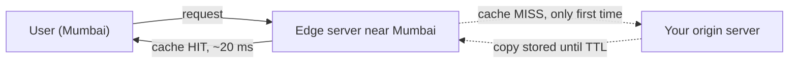

> **Ek line yaad rakho:** copy paas rakho, server bachao.

## Set it up (about 10 minutes)

1. Create a Cloudflare account → **Add a site** → enter your domain → choose the **Free** plan.
2. Cloudflare gives you two nameservers. At your domain registrar (GoDaddy, Namecheap, …) replace the old nameservers with these. The switch can take a few minutes to a few hours.
3. In the **DNS** tab, keep your record's cloud **orange (Proxied)**. A grey cloud means DNS only, with no CDN.
4. Check it works:

```bash
curl -sI https://yoursite.com/logo.png | grep -i cf-cache-status
# first request:  cf-cache-status: MISS
# next request:   cf-cache-status: HIT   ← served from the CDN
```

By default Cloudflare caches static files such as images, CSS and JS, not HTML pages. Caching HTML needs separate Cache Rules. Check Cloudflare's site for the current free-plan limits.

## How a CDN works inside



- The request goes to the **edge** server closest to the user.
- If the edge has a copy, that is a **cache hit** and the origin is never touched.
- If not, that is a **cache miss**: the edge fetches the file from the origin once, keeps it, and serves everyone after that from the copy.
- Result: a faster site, less load on your server and a smaller bandwidth bill.

## Interview words

| Term | Meaning |
|------|---------|
| Edge / PoP | CDN server close to the user |
| Origin | Your real server |
| Cache hit / miss | Copy found / not found at the edge |
| TTL | How long a copy stays valid |
| Cache-Control | HTTP header that sets the TTL |
| Purge | Force-remove a copy from the CDN |

## Follow-up questions

**The file changed but the old copy is still cached. What now?**
Three options: keep the TTL short, purge the file on the CDN, or (best) change the file name, e.g. `app.v2.css` or `app.3f9a.css`. A new name means a new cache entry, so stale copies never matter. This is called **cache busting**.

**Can you cache everything?**
No. Static files (images, CSS, JS, video) yes. User-specific data (cart, profile, balance) no, or one user's data can be shown to another.

**What if every edge misses at the same time?**
The origin gets a sudden spike. An **origin shield**, a central cache layer between the edges and the origin, absorbs it so fewer requests reach the origin.

## Go deeper

- [CDN](/sd/building-blocks/cdn): pull vs push, invalidation, content types
- [Caching strategies](/sd/building-blocks/cache-strategies)
- [DNS](/sd/building-blocks/dns): what the nameserver switch actually changes
