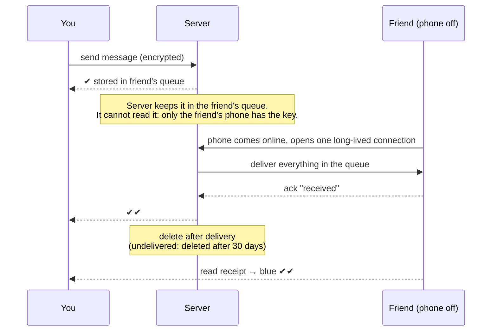

> **Ek line yaad rakho:** ek tick server ka, do tick dost ka.

This is the classic interview answer, not WhatsApp's exact internal system.

## What the ticks mean

| Tick | Meaning | Who confirmed it |
|------|---------|------------------|
| ✔ grey | Message reached the server | Server |
| ✔✔ grey | Message reached your friend's phone | Friend's phone (delivery ack) |
| ✔✔ blue | Your friend read it | Friend's phone (read receipt) |

## The flow

1. You send → it reaches the server → **1 tick**.
2. Your friend is offline → the server keeps the message in **your friend's queue**. It is end-to-end encrypted, so the server cannot read it.
3. Your friend's phone comes online → it opens a **long-lived connection** to the server → the server pushes the whole queue down that connection. The phone does not have to keep asking (no polling).
4. The phone says "received" (**ack**) → **2 ticks**. Read → **blue**.
5. After delivery the server deletes its copy. If a message is never delivered, WhatsApp's privacy policy says it is deleted after 30 days.

## Interview words

| Term | Meaning |
|------|---------|
| Store and forward | Keep the message first, forward it later |
| Message queue | Each user's line of pending messages |
| End-to-end encryption | Nobody in between can read it, including the server |
| Persistent connection | Stays open (e.g. a WebSocket) so the server can push |
| Delivery ack | The "received" signal from the device |
| Push notification | Wakes an app that is closed |

## Follow-up questions

**What if the ack is lost? Does the message arrive twice?**
If the server never gets the ack, it sends again. Every message carries a **unique message ID**, and the phone ignores an ID it has already seen. This is **idempotent delivery**.

**How is the order kept right?**
Messages in a chat carry a **sequence number**. The phone orders by it, even if the network delivers them out of order.

**A group has 200 people. Then what?**
One message goes into 200 queues. This is **fan-out**, and its cost on big groups is a favourite follow-up.

**The app is closed and there is no connection. How did the notification arrive?**
The server asks the phone's OS to send a **push notification** (FCM on Android, APNs on iPhone). It wakes the app, the app opens the connection, and it downloads the queue.

## Go deeper

- [WhatsApp case study](/hld/whatsapp): full high-level design
- [Message queues](/sd/building-blocks/message-queues)
- [WebSockets](/sd/communication/websockets)
- [Idempotency](/sd/design-patterns/idempotency)
