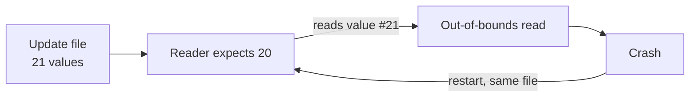
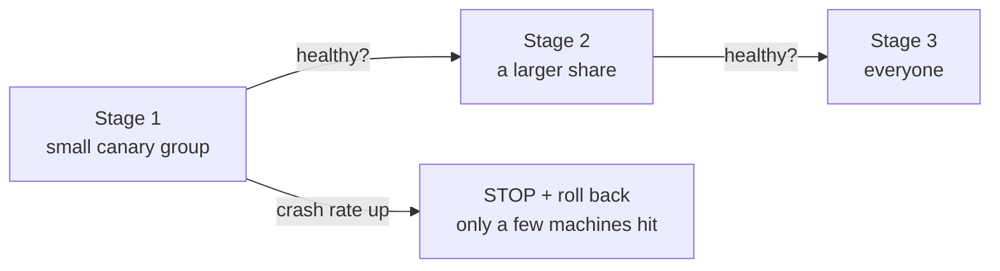

> **Ek line yaad rakho:** update sabko ek saath kabhi mat bhejo.

## What happened

On **19 July 2024**, airports, banks and hospitals around the world saw Windows PCs stuck on a crash screen. Microsoft estimated about **8.5 million** devices were affected. The cause was one small content update for CrowdStrike's security software.

- CrowdStrike's sensor runs deep inside Windows (kernel level), so when it crashes, the whole machine crashes.
- The new file (Channel File 291) used **21 input fields**, but the code that read it supplied only **20 values**.
- Reading the 21st value was an **out-of-bounds memory read**: the code touched memory that did not exist, and Windows crashed.
- Restarting did not help: the same file loaded again and crashed again (a **boot loop**).
- The file went to **every machine at once**. It was live for about **78 minutes** (04:09–05:27 UTC), and by then millions of machines were down.

## The interview answer: canary rollout

1. Ship the update to a **small canary group** first.
2. Watch crash rates and health signals.
3. If healthy, widen to a larger share, then to everyone.
4. If anything breaks, **stop and roll back**. Only the canary group is affected.

After the incident CrowdStrike said it would roll out these updates in stages starting with a canary deployment, add more testing and validation, and give customers control over when updates arrive.

## Interview words

| Term | Meaning |
|------|---------|
| Canary rollout | Release to a small group first, then widen |
| Staged / phased deployment | Release in steps with health checks between |
| Blast radius | How much breaks if a change is bad |
| Out-of-bounds read | Reading memory past the end of an array |
| Rollback | Return to the last good version |
| Kill switch | A flag that turns a change off instantly |

## Follow-up questions

**Their validator passed the file. Why wasn't testing enough?**
The validator checked the file against 21 fields while the code that read it supplied only 20, so the test agreed with the file instead of with the real reader. Tests that do not run on real machines miss this. A staged rollout is the safety net for exactly this kind of gap.

**This was a "content" update, not a code update. Does staging still apply?**
Yes. Config, data and rules files change behaviour just like code, so they need the same staged rollout. Treating config as safe to push everywhere at once is the core mistake here.

**How do you pick the canary group?**
A small, representative slice: different hardware, OS versions and regions, plus internal machines first. It should be large enough to show a problem quickly and small enough that a failure stays contained.

## Go deeper

- [Circuit breaker](/sd/design-patterns/circuit-breaker): limiting the blast radius at runtime
- [Failover](/sd/fundamentals/failover)
- [Service mesh](/sd/architecture/service-mesh): traffic-shifting for canary releases

*Source: CrowdStrike's root cause analysis (Aug 2024) and reporting by TechTarget and Help Net Security. The 8.5M figure is Microsoft's estimate.*
