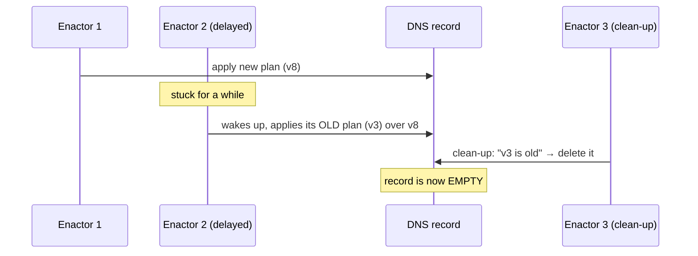

> **Ek line yaad rakho:** robot pe bhi pehra lagao.

## What happened

On **19–20 October 2025**, thousands of apps including Snapchat and Slack went down for hours. The cause, in AWS's own post-event summary, was an **empty DNS record** for DynamoDB in the us-east-1 region.

- Apps reach DynamoDB through an address: `dynamodb.us-east-1.amazonaws.com`.
- **DNS** is the internet's phone book: it says which servers sit behind that address.
- AWS keeps this phone book updated with automation: a **planner** writes new plans, and three independent **enactors** (one per availability zone) apply them. In the reel these are the three robots.

## The race



1. One enactor got **delayed**. Its freshness check had passed earlier, but was stale by the time it ran.
2. It applied its **old plan** over the newer one.
3. Another enactor's **clean-up** deleted old plans, including the one now in use.
4. The address was left with **no IP addresses at all**, and the automation could not repair it. Engineers fixed it by hand.

Every app asking "where is DynamoDB?" got an empty answer. AWS systems that depend on DynamoDB, such as EC2 and Lambda, were hit too. DNS was restored in about three hours, and full recovery across services took about **15 hours**.

## The interview answer: race condition + version check

A **race condition** is when two workers change the same thing and the result depends on who finishes when.

The fix is to make every write **conditional**:

```text
write(plan) only if plan.version > current.version
```

- Every plan carries a **version number**.
- An old plan (v3) can never overwrite a newer one (v8). The write is rejected.
- A guard refuses to publish an **empty** record, whatever the automation says.

AWS said it disabled this automation worldwide until the race is fixed and protections are added that block incorrect DNS plans.

## Interview words

| Term | Meaning |
|------|---------|
| Race condition | The result depends on timing between workers |
| Compare-and-set (CAS) | Write only if the current value is what you expect |
| Optimistic concurrency | Version check on write instead of locking |
| Fencing token | A rising number that rejects writes from stale workers |
| Stale read | Acting on data that changed after you read it |
| Blast radius | How far one failure spreads |

## Follow-up questions

**Why not just use a lock?**
A lock helps, but a worker that pauses while holding the lock (GC, network, a slow machine) can still wake up and write. A **fencing token** or version check rejects the stale write even then.

**There were three enactors for resilience. Why did redundancy make it worse?**
Redundant workers acting on shared state without coordination can conflict. Redundancy protects against a worker dying, not against workers disagreeing.

**How would you limit the damage next time?**
Validate before publishing (never publish an empty record), keep the last known-good record to fall back on, and make sure dependent systems can run on cached DNS answers for a while.

## Go deeper

- [DNS](/sd/building-blocks/dns)
- [Distributed locking](/sd/building-blocks/distributed-locking)
- [Leader election](/sd/building-blocks/leader-election)
- [Vector clocks](/sd/fundamentals/vector-clocks)

*Source: AWS post-event summary for the October 2025 us-east-1 disruption; affected apps as reported by ThousandEyes.*
