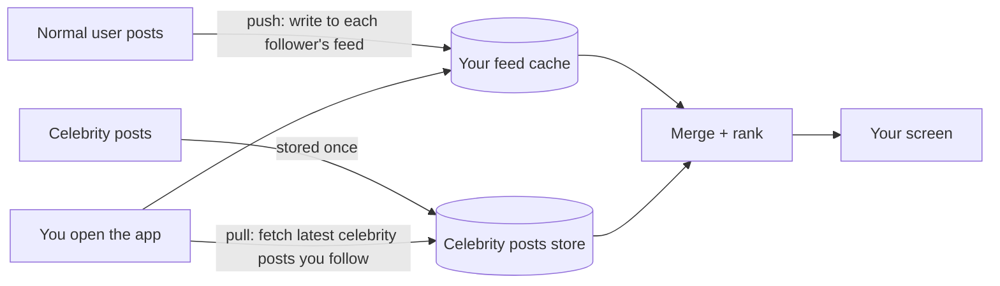

> **Ek line yaad rakho:** chhote ko push karo, bade ko pull.

This is the classic interview answer for news feeds (Twitter, Instagram-style), not Instagram's exact internal system. Virat Kohli has more than 25 crore (250M) Instagram followers.

## Two ways to build a feed

| | Fan-out on write (push) | Fan-out on read (pull) |
|---|---|---|
| When work happens | When someone posts | When you open the app |
| What it does | Copies the post ID into every follower's feed | Fetches recent posts from people you follow, then merges |
| Opening the app | Very fast: the feed is ready | Slower: merge at read time |
| Posting | 1 post × N followers writes | 1 write |
| Breaks when | A celebrity posts (25 crore writes) | You follow thousands of accounts |

## The hybrid

1. **Normal users (say, under ~10k followers):** push. Each post is written into every follower's precomputed feed.
2. **Celebrities:** don't push. Their posts stay in one place.
3. **When you open the app:** read your precomputed feed, pull the latest posts from the celebrities you follow, merge, rank, show.

## Interview words

| Term | Meaning |
|------|---------|
| Fan-out on write | Push copies to followers at post time |
| Fan-out on read | Pull and merge at read time |
| Hybrid fan-out | Push for normal users, pull for celebrities |
| Celebrity / hot-key problem | One account with huge reach overloads a push design |
| Feed cache | Precomputed list of post IDs per user (often Redis) |

## Follow-up questions

**Where is the cut-off between push and pull?**
A follower threshold (e.g. 10k or 100k). Pick it from data: the write cost of push vs the read cost of merging.

**Do you copy the whole post into every feed?**
No. Only the **post ID** (and maybe a timestamp). The post itself lives once in the posts store and is fetched when shown.

**What about inactive users?**
Don't push to people who haven't opened the app in weeks. Build their feed when they come back. This saves most of the writes.

**How is the feed ordered?**
Ranking (likes, relationship, recency) happens after the merge, not during fan-out.
