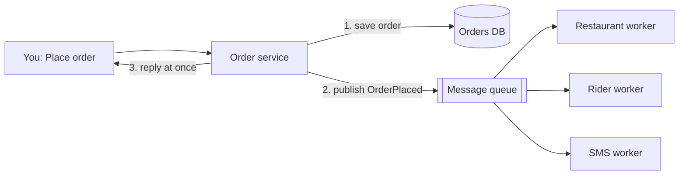

> **Ek line yaad rakho:** jawab turant do, kaam baad mein karo.

Numbers from Swiggy's IPL 2026 report: during the final (31 May, RCB vs GT) orders averaged about 1,300 a minute, peaking above 6,200 at 7:56 PM. The design below is the classic interview answer, not Swiggy's exact internal system.

## The naive design (synchronous)

The checkout request tells the restaurant, finds a rider and sends the SMS, and only then answers you. One slow step (say, the SMS provider) makes every checkout slow, and a burst of orders piles up until the app falls over.

## With a message queue

1. The order service saves the order and **publishes a message** to the queue.
2. It **replies immediately**: "order placed".
3. **Workers** (consumers) pull messages at their own speed: notify the restaurant, assign a rider, send the SMS.
4. **Peak:** the queue gets longer, but the app stays up. Add more workers to drain it faster.
5. **Worker crash:** a message is removed only after the worker **acks** it. If a worker dies mid-way, the message becomes visible again and another worker takes it.

## Interview words

| Term | Meaning |
|------|---------|
| Message queue | Buffer between the part that accepts work and the part that does it (Kafka, RabbitMQ, SQS) |
| Async processing | Reply first, do the slow work later |
| Producer / consumer | Who writes to the queue / who reads from it |
| Absorb the peak | The queue soaks up a burst so downstream systems run at a steady rate |
| Ack + redelivery | Unacked messages are delivered again |
| At-least-once delivery | A message can arrive twice, so consumers must be idempotent |
| Dead-letter queue | Where messages go after failing too many times |

## Follow-up questions

**The worker sent the SMS, then crashed before acking. What happens?**
The message is delivered again, so the SMS could go twice. Make consumers **idempotent**: store the order ID of every SMS already sent and skip repeats.

**How do you keep one order's events in order?**
Partition by **order ID** (Kafka key). All events for an order land in the same partition, which is read in order.

**What if the queue keeps growing?**
Watch **consumer lag**. Auto-scale workers on lag, and shed or delay non-urgent work (marketing SMS) during the peak.

**What should never go through the queue?**
Anything the user must see right now to decide, like payment authorisation. That stays synchronous.

## Go deeper

- [Message queues](/sd/building-blocks/message-queues)
- [Task queues](/sd/building-blocks/task-queues)
- [Pub/sub](/sd/building-blocks/pub-sub)
- [Idempotency](/sd/design-patterns/idempotency)
- [Notification system](/hld/notification-system)
