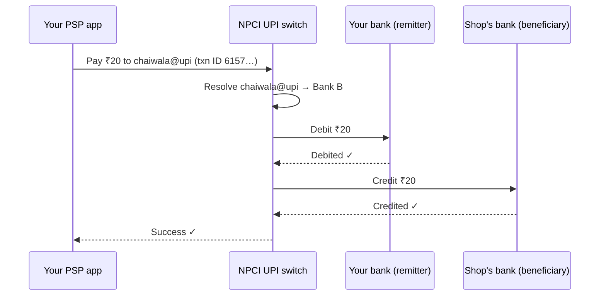

> **Ek line yaad rakho:** app sirf darwaza hai, paisa bank mein hai.

In October 2026 UPI processed 25.47 billion payments (NPCI). This is the interview-level picture of one payment, simplified.

## The stack

| Layer | Who | Job |
|------|-----|-----|
| PSP app | PhonePe, Google Pay, Paytm… | Builds the request. Holds no money. |
| UPI switch | NPCI | Routes the request. Resolves the UPI ID (VPA) to a bank account. |
| Remitter bank | Your bank | Debits your account. |
| Beneficiary bank | The shop's bank | Credits their account. |

## One payment

1. The app collects the payee and amount, and your PIN (encrypted, checked by your bank, never by the app).
2. The NPCI switch looks up which bank the UPI ID belongs to.
3. Your bank debits, the shop's bank credits, and both answers flow back through the switch to your app.

## Interview words

| Term | Meaning |
|------|---------|
| PSP | Payment Service Provider: the app and its sponsor bank |
| UPI switch | NPCI's central router between all banks |
| VPA / UPI ID | An alias like `name@bank`, resolved to an account |
| Remitter / beneficiary | Paying bank / receiving bank |
| Unique transaction ID | Every payment carries one, so a retry is recognised, not repeated |

## Follow-up questions

**The debit worked but the app showed "failed". What happens?**
The credit side timed out. The switch and banks reconcile using the transaction ID, and the money is either completed or auto-reversed to your account.

**Why can't a retry charge you twice?**
The retry carries the same transaction ID. The bank sees an ID it has already processed and returns the old result instead of debiting again (**idempotency**).

**Why is UPI so fast?**
Every step is a real-time API call between always-on systems, and settlement between banks happens later in batches.

## Go deeper

- [Idempotency](/sd/design-patterns/idempotency)
- [Stripe case study](/hld/stripe)
- [Reel #32 · UPI double debit](/reels)
