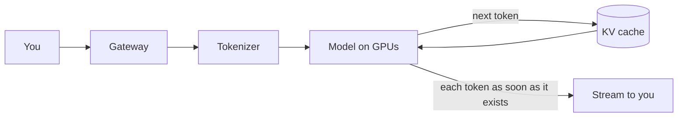

> **Ek line yaad rakho:** ek token, ek kadam.

India has more than 100 million weekly ChatGPT users (Sam Altman, Feb 2026). Below is the classic interview picture of serving a large language model, not OpenAI's exact internals.

## The stack

| Layer | Job |
|------|-----|
| Gateway | Login, rate limits, safety checks, routing |
| Tokenizer | Splits text into tokens (pieces of words) |
| GPU cluster | Runs the model. Many users' requests are **batched** together on each GPU |
| KV cache | Keeps the attention keys/values of earlier tokens so they aren't recomputed |

## Why word by word

The model predicts **one next token at a time**, then feeds it back in to predict the one after. Instead of waiting for the whole answer, the server sends every token the moment it is generated (streaming, typically over Server-Sent Events). That is why the text appears word by word, and why the first word arrives fast.

## Interview words

| Term | Meaning |
|------|---------|
| Tokenization | Text → token IDs |
| Autoregressive decoding | Generate one token, append it, repeat |
| Batching | Serve many requests together to keep GPUs busy |
| KV cache | Stored keys/values for earlier tokens; makes each new token cheap |
| Streaming (SSE) | Push tokens to the client as they are produced |
| TTFT | Time to first token, the latency users feel |

## Follow-up questions

**What limits how many users one GPU can serve?**
GPU memory: model weights plus the KV cache of every active conversation. Longer chats mean bigger caches.

**How do you handle a traffic spike?**
Rate limits at the gateway, queueing, autoscaling GPU workers, and smaller/faster models for overflow.

**Why not just return the full answer at once?**
Users would wait for the slowest part. Streaming makes the first token show up in well under a second.
