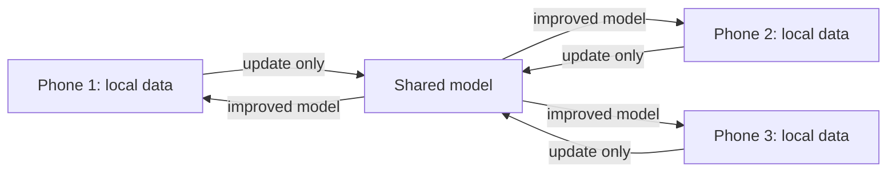

> **Ek line yaad rakho:** keyboard tumhe padhta nahi, predict karta hai.

## 1. Which key did you press?

A fingertip is bigger than a key and often lands between two. The keyboard doesn't pick the nearest key blindly: a **spatial (touch) model** gives every nearby key a probability (in the reel: J 70%, K 30% — an illustration). That uncertainty is passed on, not thrown away.

## 2. What word comes next?

A small **language model** scores possible next words given what you've typed ("kal" → milte, office, pakka). The decoder combines touch probabilities with language probabilities and shows the top three. Gboard's Hinglish layout does the same for Roman Hindi.

## 3. Why it runs on the phone

Suggestions have to appear while your finger is still moving. A round trip to a server would arrive late, and it would also mean sending everything you type. So the model runs **on-device**, which also means it works offline.

## 4. How it learns without reading your text

Google tested **federated learning** in Gboard: phones train on local data and send only a small, aggregated **model update** to the server; the typing itself stays on the phone ([Google AI Blog, 6 Apr 2017](https://research.google/blog/federated-learning-collaborative-machine-learning-without-centralized-training-data/)).

## The interview answer: typeahead

"Design autocomplete / typeahead" is a classic system-design question.

- Store completions in a **trie** (prefix tree).
- At every node, **precompute the top-k** completions (by frequency / recency), so a lookup is just walking the prefix: `ka` → kal, kaam, kahan. No search at query time.
- Keep it **close to the user**: on-device for a keyboard; for web search, a cache/edge layer in front of the trie servers.
- Update ranks **offline** (batch job) and ship new snapshots; don't rebuild on every keystroke.
- Talk about: latency budget per keystroke, memory of top-k per node, personalisation, and privacy.

**Words to say:** trie, top-k per prefix, precompute, on-device, federated learning.

*Sources: Google AI Blog, "Federated Learning: Collaborative Machine Learning without Centralized Training Data" (Apr 2017); Google AI Blog, "The Machine Intelligence Behind Gboard" (May 2017). On-screen probabilities are illustrations.*
