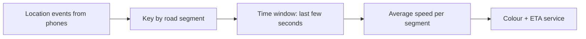

> **Ek line yaad rakho:** Maps ne sadak nahi dekhi. Usne phones gine.

## The story

In February 2020 the artist **Simon Weckert** pulled a handcart with **99 secondhand smartphones**, all running Google Maps, down empty streets in Berlin. Maps showed those streets as a traffic jam (red) and rerouted drivers ([The Register, 3 Feb 2020](https://www.theregister.com/2020/02/03/google_maps_hack_cartful_phones/)).

## How live traffic works

1. **Phones are the sensors.** Google says "aggregate location data can be used to understand traffic conditions on roads all over the world" — phones with location on report where they are and how fast they move, anonymously ([Google, "Google Maps 101", 3 Sep 2020](https://blog.google/products/maps/google-maps-101-how-ai-helps-predict-traffic-and-determine-routes/)).
2. **Roads are split into segments.** Each short stretch gets the average speed of the phones on it right now.
3. **Speed → colour.** Normal speed = green, slow = orange, very slow = red.
4. **ETA uses history too.** Maps combines live conditions with historical traffic patterns for that road and time; Google says its ETAs have been accurate for **over 97% of trips**.

99 phones moving at walking pace on one segment look exactly like 99 cars stuck in a jam — the average speed drops, so the road turns red.

## The interview answer: stream aggregation

- **Partition by key** (road segment id / geohash) so all events for one segment land on the same worker.
- **Windowed aggregation** (tumbling or sliding window of a few seconds to a minute): average / median speed, count of devices.
- **Guard against weird inputs**: minimum distinct devices, outlier filtering, compare with the historical baseline — the Weckert cart is exactly the case a count-only rule misses.
- **Serve from a fast store** (segment → current speed) that the map tiles and the routing/ETA service read.

**Words to say:** stream processing, partition by segment, time window, aggregation, historical baseline.

*Sources: The Register (3 Feb 2020); Google blog "Google Maps 101: How AI helps predict traffic and determine routes" (3 Sep 2020). Segment speeds in the reel are illustrations.*
