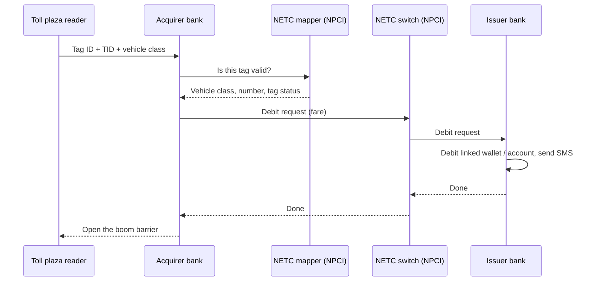

> **Ek line yaad rakho:** sticker pe sirf pehchaan, paisa bank ke server pe.

## What's in the sticker
- FASTag is a **passive RFID tag** stuck on the windscreen ([NETC](https://www.netc.org.in/about-netc-fastag)). No battery: the toll reader's radio wave powers the chip for a moment, and it answers with its **IDs** (Tag ID, TID).
- No money and no GPS on the sticker. It is linked to one vehicle and can't be moved to another.

## One toll crossing

If the issuer bank doesn't answer within the set time, NETC treats the transaction as **deemed accepted**, so the lane keeps moving; disputes and adjustments are settled later in clearing.

## The interview answer: passive RFID + state on the server
- **Identifier, not data:** the device carries only an ID. Balance, status and blacklist live on the server, so a lost sticker is fixed by blocking its ID, not by recovering the sticker.
- **Registry lookup:** the mapper is a lookup service (tag → vehicle, status) every acquirer asks before charging.
- **Don't block the gate on a slow dependency:** deemed acceptance + later reconciliation keeps the plaza available and fixes mistakes afterwards.

**Words to say:** passive RFID, identifier vs state, registry (mapper) lookup, deemed acceptance, reconciliation.

## Follow-up questions

**Why not keep the balance on the sticker?**
A tag that holds money can be cloned or tampered with, and losing it would lose the money. With a **server-side ledger** the bank is the single source of truth and the sticker is just a key.

**What happens if the bank is down when you cross?**
The toll can't wait. NETC uses **deemed acceptance** after a timeout and corrects the books later in **clearing and settlement**, an availability-first choice with eventual correction.

*Flow simplified from NPCI's NETC description; the plaza, banks and SMS in the reel are illustrations.*
