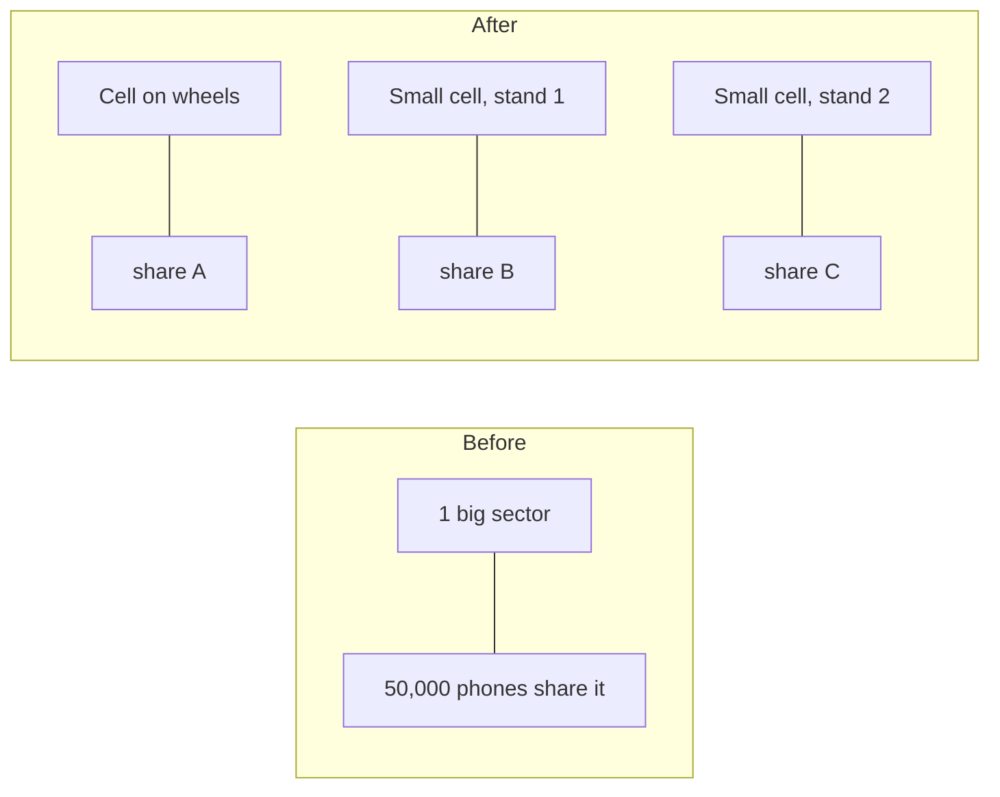

> **Ek line yaad rakho:** signal pahunchna alag, sabko jagah milna alag.

## Bars are not capacity
- The **bars** show signal strength: how close and clear the tower is.
- Each cell sector has a **fixed slice of spectrum**, shared by every phone attached to it. A normal evening: a few hundred phones. A match: tens of thousands in the same few sectors, so everyone's share shrinks.
- Uploads make it worse: stories and videos all leave the stadium at the same moment.

## The fix: more, smaller cells

Operators add **cells on wheels (COWs)**, extra towers and stronger sites around big matches. Airtel did exactly this at Guwahati's Barsapara stadium for IPL 2025 ([TelecomTalk](https://telecomtalk.info/bharti-airtel-boosts-network-connectivity-at-barsapara/991958/)). Small antennas inside the stands split one crowded cell into many lighter ones.

## The interview answer: capacity vs coverage
- **Coverage:** can the signal reach you? **Capacity:** how many users can it serve at the same time?
- Backend version: a server that passes its health check can still be saturated. Green is not the same as "has room".
- **Cell splitting = horizontal scaling:** more, smaller units, each serving fewer users.

**Words to say:** capacity vs coverage, shared medium, contention, cell splitting, horizontal scaling, capacity planning.

## Follow-up questions

**Why does a WhatsApp text go through when a reel won't load?**
A text is a few hundred bytes; a reel needs a continuous stream of megabytes. On a congested cell, small requests still squeeze through while large ones time out.

**You're the operator for a cricket final. What do you do?**
Plan **capacity**, not just coverage: COWs and small cells for more sectors, prioritise traffic, and add capacity for the peak (the moment after a wicket), not the average.

*The phone counts in the reel are illustrations.*
