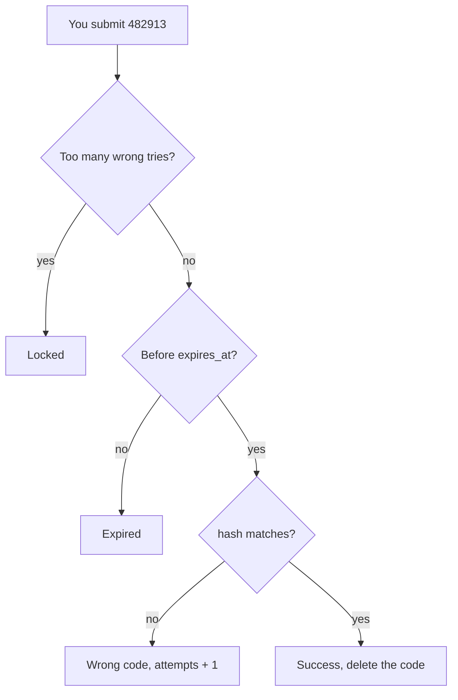

> **Ek line yaad rakho:** code wahi, ghadi aage.

## The SMS has no timer
- An SMS is plain text. Your phone has no idea when the code expires.
- The **bank's server** creates a random code, saves it (ideally hashed) together with an **expires_at** time against your login or payment, and only then sends the SMS.

## What happens when you type the code

## The interview answer: TTL + rate limit + hashing
- **TTL (time to live):** store the expiry with the code. In Redis, `SET otp:<session> <hash> EX 300` expires it for you.
- **Rate limit:** a 6-digit code has only 10 lakh combinations, so cap wrong attempts and resends, or it can be brute-forced.
- **Hash at rest, one-time use:** store a hash, delete it on success, and bind it to that one session or transaction.
- **Authenticator apps (TOTP, [RFC 6238](https://datatracker.ietf.org/doc/html/rfc6238)):** the code is computed from a shared secret and the current 30-second time step, so nothing is sent by SMS and the server just recomputes it.

**Words to say:** TTL, expires_at, rate limiting, hashing, one-time use, TOTP.

## Follow-up questions

**Why not let the app check the expiry?**
The client is untrusted: anyone can change the phone's clock or the app. Expiry has to be enforced on the **server**.

**SMS OTP or authenticator app?**
SMS can be delayed or stolen with a SIM swap. TOTP works offline and never travels over the network, but you have to protect the shared secret at setup.

*The 7:42 expiry and the three-try lock in the reel are illustrations; every bank sets its own limits.*
