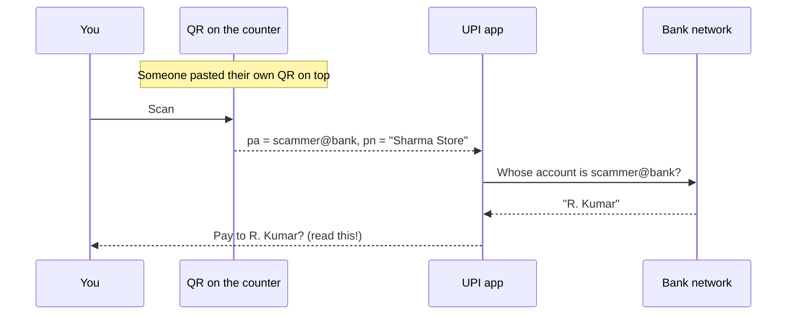

> **Ek line yaad rakho:** QR sirf pata hai, pehchaan naam se.

## What's inside the QR
Scan it and you get one line of text, for example:

```text
upi://pay?pa=sharma.store@okbank&pn=Sharma%20General%20Store&cu=INR
```

- **pa** = payee address, the UPI ID the money goes to.
- **pn** = payee name, just text. Anyone can type anything here.

## The name you should read
Before you enter your PIN, the app asks the network whose account that UPI ID belongs to and shows the **bank-registered name**. Since 30 June 2025, UPI apps must show only the name from the bank's core banking system, not the QR name or a nickname ([Outlook Money](https://www.outlookmoney.com/banking/upi-to-display-verified-names-of-recipients-from-june-30-2025)).

## The scam



The sticker looks the same, but the UPI ID inside is different. The QR's own name field can say anything; the bank-verified name can't.

## The interview answer: untrusted input
- Never trust data that comes from the client side (here, the QR's **pn**). Resolve identity on the **server**, from the source of truth (the bank).
- Show the verified result to the user **before** an irreversible action.

**Words to say:** untrusted input, server-side validation, source of truth, confirmation step.

## Follow-up questions

**Why can't UPI just block fake QR codes?**
A QR is plain text and the scammer's UPI ID is a real, valid account. The defences are the **verified name** before payment, the shop's sound box or confirmation, and fraud reporting on the receiving account.

**Where else does this pattern show up?**
Anywhere the client sends data you then act on: prices in a checkout request, user IDs in an API call, file names in an upload. Re-check them on the server.

*The shop, UPI ID and app screen in the reel are illustrations.*
