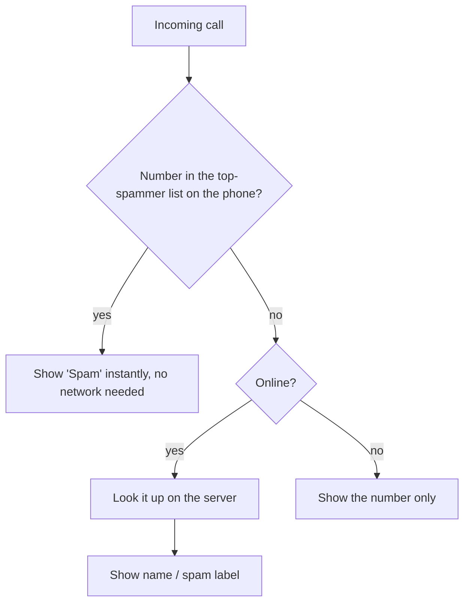

> **Ek line yaad rakho:** naam network batata hai, niyat log batate hain.

## 1. The crowd decides
- When people report a number as spam, the reports add up. A number with many reports is marked spam; if reports drop **below a threshold** over time, it's de-listed again ([Truecaller support](https://truecallercare.freshdesk.com/support/solutions/articles/81000392568-what-is-spam-)).
- Scale: Truecaller says it identified **4,168 crore** spam calls in India in 2025 ([its 2025 India report](https://theprint.in/ani-press-releases/indias-spam-shield-the-truecaller-community-blocked-nearly-1200-crore-unwanted-calls-in-2025/2851847), company figures).

## 2. Why it's instant

The app downloads **a list of the top spammers in your area** to the phone ([Truecaller support](https://truecallercare.freshdesk.com/support/solutions/articles/81000410400-how-can-i-update-my-spam-list-)), so the worst numbers are caught without waiting for the network. Everything else is a server lookup.

## 3. The twist: CNAP
- From **1 November 2026**, Indian networks show the caller's name by default on 4G/5G calls: **Calling Name Presentation (CNAP)**. The name comes from the operator's subscriber (KYC) record and isn't stored after the call ([Inc42](https://inc42.com/buzz/centre-directs-telcos-to-display-caller-names-from-november-1/), [PNN](https://pnndigital.com/national/indias-cnap-caller-name-display-goes-live-on-4g-and-5g-networks-from-november-1/)).
- It tells you **whose SIM** it is, not who is calling or why. Fraudsters often use SIMs registered in someone else's name, so the name can look perfectly real.

## The interview answer
- **Hot-key cache:** keep the most-requested keys (the top spammers) closest to the user, on the device; fetch the long tail from the server.
- **Crowd reputation:** count reports per number, mark it past a **threshold**, let old reports **decay** so the tag can come off.
- **Source of truth vs reputation:** the KYC name is authoritative identity; reports are a reputation signal. You need both.

**Words to say:** hot-key cache, threshold, time decay, crowdsourcing, source of truth vs reputation.

## Follow-up questions

**How do you stop people mass-reporting a rival's number?**
Count **unique** reporters, rate-limit each reporter, weight reports by the reporter's own history, let old reports decay, and give owners an appeal path.

**How do you keep the on-phone list fresh without downloading everything?**
Cap it to the top N numbers for the user's region, sync **deltas** (added/removed) on a schedule, and give entries a TTL so stale ones drop out.

*Simplified: caller-ID apps don't publish their exact rules; this is the classic interview answer. The number, name and report count in the reel are illustrations. Not affiliated with Truecaller.*
