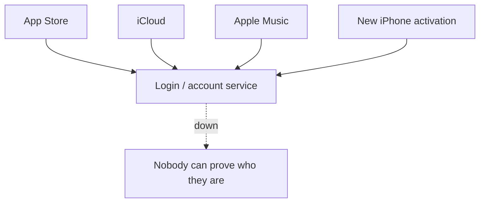

> **Ek line yaad rakho:** darwaza ek ho, toh chaabi sambhal ke badlo.

## What happened
- **17 Nov 2026**, from about 11:45 a.m. ET (around 10:15 PM IST): Apple's status page listed **iCloud Account & Sign In** as affecting all users. The App Store, Apple Music, AppleCare, iCloud Mail and iCloud.com were also hit; people were signed out or asked for their Apple Account password, and some couldn't activate new iPhones ([TechCrunch](https://techcrunch.com/2026/11/17/apple-services-including-icloud-app-store-and-apple-music-hit-by-outage/)). Purchases in Apple's retail stores failed too ([MacRumors](https://www.macrumors.com/2026/11/17/apple-outage-internal-update/)).
- **Cause, per Apple:** "an internal update caused some outages", not a cyberattack. Everything showed as resolved by about 6 PM ET.

## Why one update hits everything

Every service first asks "who is this user?", and one shared login service answers. When it fails, the services behind it are healthy but useless. Apple hasn't published its internals; this is the classic interview reading of the symptoms.

## The interview answer: single point of failure + staged rollout
- **Single point of failure:** one shared dependency that everything needs. Find these first in any design.
- **Staged rollout:** ship a change to ~1% of users or one region, watch error rates, then widen. Roll back automatically when errors jump.
- **Graceful degradation:** don't log people out when the login service is sick; let existing sessions keep working on their current token.
- **Blast radius:** split the service into independent cells so a bad update hits one cell, not everyone.

**Words to say:** single point of failure, staged rollout, canary, rollback, graceful degradation, blast radius.

## Follow-up questions

**You can't remove the login service. How do you make it safer?**
Run it in independent **cells** (by region or user shard), deploy to one cell at a time, keep tokens verifiable locally (signed tokens) so other services don't call it on every request, and cache recent results.

**Why not just make every service do its own login?**
Then you have many copies of security-critical code to keep in sync. Centralised identity is right; it just needs the strictest rollout process in the company.

*Illustrations simplified; not affiliated with Apple.*
