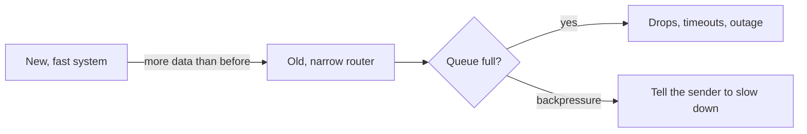

> **Ek line yaad rakho:** naya tez ho, toh purane se poochh ke chalo.

## What happened
- **13 Nov 2026**, 3:54 pm ET: the FAA stopped flights nationwide; airspace reopened at 8:15 pm ET. FlightRadar24 counted **4,700+ cancellations** and **10,000 delays** that day ([Al Jazeera](https://www.aljazeera.com/news/2026/11/14/faa-ground-stop-lifted-why-were-us-flights-grounded-and-whats-next)).
- **Cause, per US officials:** a telecommunications outage at air route traffic control centres. Switches and routers were overloaded with data; new technology added to the system overloaded older parts. No cyberattack.
- Technicians linked it to a newly installed router; the FAA paused new installations while the root cause is investigated (The National News Desk, 17 Nov 2026).

## The pump and the pipe

## The interview answer: backpressure + load testing
- **Backpressure:** when a downstream part can't keep up, it signals upstream to slow down (bounded queues, flow control, 429s) instead of being flooded.
- **Load test the whole path** with the new component at full traffic before cutover, not just the new part on its own.
- **Capacity planning:** the slowest, oldest link sets the real capacity of the chain.
- **Graceful degradation:** shed non-critical traffic first so the critical messages still get through.

**Words to say:** backpressure, bounded queue, load testing, capacity planning, graceful degradation.

## Follow-up questions

**Why not just upgrade the old routers too?**
Ideally yes, but big systems are upgraded piece by piece. During the mix, the new parts must respect the old parts' limits: that's what backpressure and staged cutovers are for.

**How does a queue help, and when does it hurt?**
A queue absorbs short bursts. If input stays higher than output, it only delays the failure, which is why queues need a **limit** plus a signal back to the sender.

*The pump-and-pipe picture is an illustration; the FAA's final root cause is still under investigation.*
