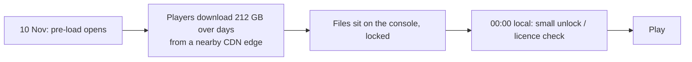

> **Ek line yaad rakho:** jo kaam aakhri pal ka hai, use sabse halka rakho.

## What happened
- **GTA 6 became playable at "midnight local time on Thursday, 19 November"** on PS5 and Xbox Series X|S, so New Zealand got it first and the Americas last ([IBTimes UK, quoting Rockstar](https://www.ibtimes.co.uk/quick-facts-about-gta-6-preload-start-times-file-size-global-midnight-release-schedules-1831139)).
- **Size:** Rockstar's pre-load FAQ asks for **up to 212 GB** of free storage, depending on the device.
- **Pre-load opened on 10 November**: at local midnight per region on PS5, and at one worldwide time (midnight GMT) on Xbox. Boxed copies carry a download code, not a disc.
- **The day before launch**, PS5 users reported PlayStation Network errors (a Downdetector spike from about 1 pm ET), and some struggled to redeem codes or upgrade editions; downloads were slow or stalled for some in Europe but went through on retry ([GamesRadar+, 18 Nov 2026](https://www.gamesradar.com/games/grand-theft-auto/ps5-users-report-playstation-network-errors-as-gta-6-fever-hits-with-some-struggling-to-redeem-codes/)). Sony gave no cause.

## The math: why midnight downloads would never work
212 GB × 8 = 1,696 Gb = 1,696,000 Mb. At 100 Mbps that is 16,960 seconds, about **4.7 hours** for one player on a good home line. Multiply by millions of players starting in the same minute and no network has that headroom.

## How the launch avoids the crowd

1. **Move the heavy work earlier (pre-positioning).** The big download happens over a week, spread across days and from CDN servers near each player.
2. **Make the midnight step tiny.** At release, the console only needs a small unlock: a licence or entitlement check (simplified; Sony and Microsoft don't publish the details).
3. **Spread the crowd over time.** Midnight *local* time means the unlock rolls around the planet as a wave (New Zealand → Asia → Europe → the Americas) instead of one global spike.

| Midnight local | In IST |
|---|---|
| New Zealand (NZDT, UTC+13) | 18 Nov, 4:30 PM |
| India | 19 Nov, 12:00 AM |
| UK (GMT) | 19 Nov, 5:30 AM |
| New York (EST, UTC−5) | 19 Nov, 10:30 AM |

## The interview answer: thundering herd
- **Thundering herd:** many clients ask for the same thing at the same moment (a cache key expiring, a service restarting, a game unlocking), and the spike overwhelms the backend.
- **Fixes:** pre-compute or pre-position the heavy part; keep the hot-moment request small; add **jitter** so clients don't retry in sync; **stagger** releases by region or cohort; put a **queue** or **rate limit** in front of the small step.
- **The twist:** small steps can still jam. Code redemption and edition upgrades ran into errors for some players the day before launch (Sony gave no cause). Whatever has to happen near the hot moment needs its own protection.

**Words to say:** thundering herd, pre-positioning, CDN, jitter, staggered rollout, rate limiting.

## Follow-up questions

**Why not just add more servers for launch night?**
You can, for the small unlock step. But 212 GB × millions of players in one hour is far beyond any CDN's spare capacity, and that capacity would sit idle the rest of the year. Moving the work earlier is far cheaper than buying for the peak.

**How would you protect the code-redemption service?**
Let people redeem early (as soon as they buy), cache entitlement checks, queue requests with a visible wait time instead of failing, and make clients retry with exponential backoff plus jitter so failures don't come back in synchronized waves.

*Illustrations simplified; fan explainer, not affiliated with Rockstar Games, Take-Two, Sony or Microsoft.*
